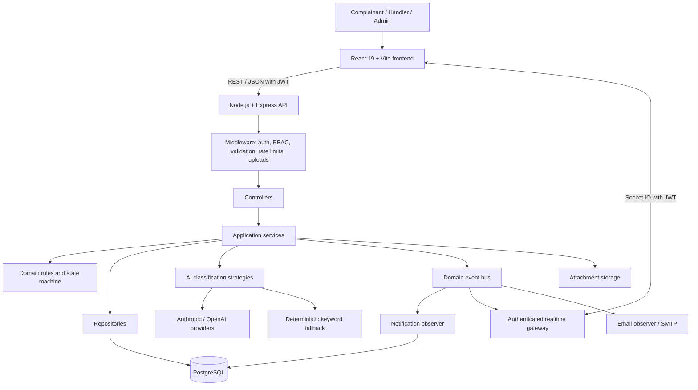
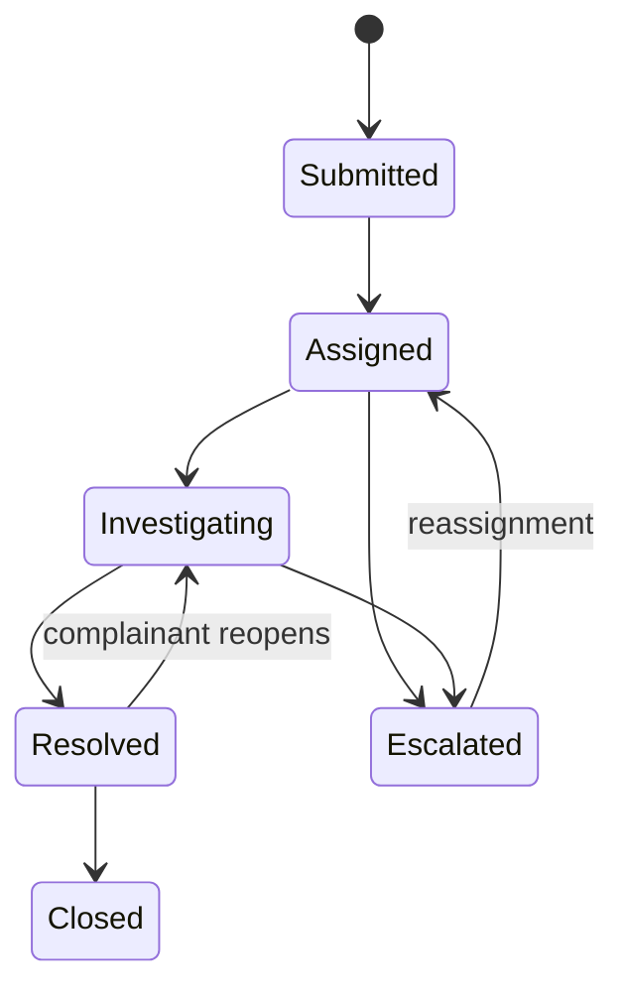

# ResolveX — System Architecture

## 1. Overview

ResolveX is an AI-assisted institutional grievance-management platform. It provides a citizen/student portal, department-handler workflows, and administrator oversight. Its core guarantees are controlled complaint-state transitions, traceable activity history, deadline-aware escalation, and notifications to affected users.

This document describes the **implementation in this repository**. It distinguishes the deployed application structure from logical service boundaries used in the design.

## 2. Architecture at a glance

### Main technologies

| Layer | Technology | Responsibility |
|---|---|---|
| Web client | React 19, Vite, Tailwind CSS 4 | User portals, dashboards and interaction |
| HTTP API | Node.js, Express 5 | Request handling and application workflows |
| Realtime | Socket.IO | Authenticated live events and user-room updates |
| Persistence | PostgreSQL, node-postgres (`pg`) | Relational records, constraints and transactions |
| AI classification | Provider strategies with deterministic keyword fallback | Category and priority triage |
| Email | Nodemailer / SMTP configuration | Outbound email delivery |
| Attachments | Upload service with configured remote/local storage behaviour | Complaint evidence handling |
| Tests | Node.js built-in test runner | Automated unit tests |

> **Implementation note:** The current repository's AI classifier is implemented as a backend service with interchangeable provider strategies and a keyword fallback. It is not a separately deployed Python microservice. Likewise, the current server uses its configured rate-limiting implementation; Redis is not a required runtime dependency in the repository's documented local setup.

## 3. Backend request flow

The backend follows a layered structure:

1. **Routes** declare HTTP endpoints and compose middleware.
2. **Middleware** authenticates requests, checks roles, validates input, applies rate limits and handles uploads.
3. **Controllers** translate HTTP requests into application-service calls and format responses.
4. **Services** coordinate use cases such as complaint creation, transitions, classification and escalation.
5. **Domain layer** owns business rules, including legal complaint-state transitions.
6. **Repositories** encapsulate PostgreSQL queries.
7. **Events and observers** deliver notifications, realtime updates and email after domain operations commit.

This separation keeps HTTP concerns, business rules and persistence concerns from becoming one large controller.

## 4. Core components

### 4.1 React client

The client provides role-oriented experiences:

- Student/citizen portal for filing complaints, viewing status and following the timeline.
- Handler dashboard for assigned work and permitted status transitions.
- Administrator dashboard for oversight, analytics and escalation review.

The client communicates with the API using REST and uses Socket.IO for realtime updates when the hosting environment supports persistent connections.

### 4.2 Authentication and authorization

The API authenticates users and applies role-based access control. Roles represented by the database enum are `student`, `handler` and `admin`. Protected routes use authentication middleware; administrative routes additionally apply the admin guard.

### 4.3 Complaint service and state machine

Complaint creation and lifecycle transitions are coordinated by the complaint service. The State pattern in `server/src/domain/complaintState.js` validates whether a requested transition is legal for the current state and actor. PostgreSQL enums and CHECK constraints provide a second layer of data integrity.

### 4.4 AI classification

The AI module exposes a common classification interface and tries configured strategies in order. The current documented strategy chain is Anthropic, then OpenAI, then a deterministic keyword classifier. Invalid, unsupported, refused, timed-out or low-confidence model output can fall through to the next strategy. The final result includes the predicted category, priority, confidence and strategy metadata.

Classification supports triage and routing; it does not make the human resolution decision.

### 4.5 Escalation worker

The escalation subsystem evaluates eligible complaints using a Chain of Responsibility. The scheduled worker processes complaints in bounded batches. Escalation decisions are executed transactionally and recorded so repeated sweeps do not create duplicate level events.

### 4.6 Notifications and realtime events

Domain events are published after the relevant database transaction commits. Observers handle notification persistence, Socket.IO delivery and email delivery. Email and realtime delivery failures are isolated from the committed complaint transition and logged.

## 5. Complaint lifecycle

The exact allowed transitions and actor permissions are defined in the domain state implementation. The diagram above is a high-level overview; consult `complaintState.js` for the authoritative transition rules.

## 6. Data architecture

PostgreSQL is the system of record. Core entities include users, departments, complaints, complaint status history, escalations, notifications and authentication-related records. Foreign keys, unique constraints, CHECK constraints and indexes protect data integrity and query performance.

See [Database Design](database-design.md) for table-level details.

## 7. Runtime and deployment considerations

- Local development uses PostgreSQL and separate client/server development processes.
- A persistent Node.js host supports Socket.IO and the in-process scheduled escalation worker.
- Serverless deployments require platform-specific handling for scheduled jobs, uploads and realtime updates. See the root [Deployment Guide](../DEPLOYMENT.md).
- External AI providers, SMTP and remote attachment storage are configurable. The application includes fallbacks for selected optional integrations.

## 8. Architecture decision summary

| Decision | Reason |
|---|---|
| Layered backend | Separates HTTP, business logic, domain rules and data access |
| Explicit state machine | Prevents invalid lifecycle transitions |
| Strategy-based classifier | Allows provider substitution and deterministic fallback |
| Chain of Responsibility for escalation | Makes escalation policy composable and testable |
| Event observers | Decouples committed domain changes from delivery channels |
| PostgreSQL constraints and transactions | Protects consistency and auditability |
| Separate client and server applications | Allows independent development and deployment |

## 9. Source locations

- Client: `client/`
- API entry and app setup: `server/src/index.js`, `server/src/app.js`
- Routes: `server/src/routes/`
- Controllers: `server/src/controllers/`
- Domain state machine: `server/src/domain/complaintState.js`
- Complaint workflow: `server/src/services/complaintService.js`
- AI classification: `server/src/services/ai/`
- Escalation: `server/src/services/escalation/`
- Events and observers: `server/src/events/`
- Repositories: `server/src/repositories/`
- Database DDL and seed: `db/schema.sql`, `db/seed.sql`
