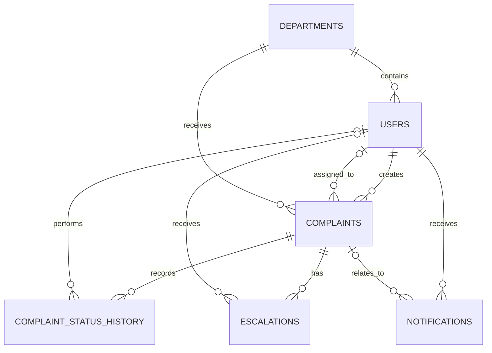

# ResolveX — Database Design

## 1. Overview

ResolveX uses PostgreSQL as its persistent relational data store. The schema is maintained in `db/schema.sql`; sample development data is provided in `db/seed.sql`.

The schema is designed around institutional users, departments, complaints, complaint history, escalation records, notifications and authentication workflows.

## 2. Core entities

| Table | Purpose | Important relationships |
|---|---|---|
| `users` | Student, handler and administrator accounts | Belongs to a department where applicable; referenced by complaints and history |
| `departments` | Institutional departments and shared department details | Has an optional HOD; users and complaints reference departments |
| `complaints` | Main grievance record | References creator, assignee and department |
| `complaint_status_history` | Append-oriented status transition history | References a complaint and optional acting user |
| `escalations` | Escalation events | References a complaint and optional escalation recipient |
| `notifications` | User-facing notification records | References a recipient and, where applicable, a complaint |
| Authentication tables | Verification codes and password-reset / OTP workflows | Associated with user identity and authentication operations |

The authoritative list of columns, constraints and indexes is in `db/schema.sql`.

## 3. Key relationships



Interpretation:

- A user can create multiple complaints.
- A complaint has one creator and belongs to one department.
- A complaint can be assigned to a handler; the assignee may be cleared if the handler account is removed.
- A complaint can have many status-history entries and escalation events.
- A user can receive many notifications.

## 4. Complaint integrity rules

The database reinforces important domain rules:

- Complaint status is restricted to the `complaint_status` enum.
- Priority is restricted to `low`, `medium`, `high` or `urgent`.
- A complaint in `Assigned` state must have an assignee.
- A complaint in `Resolved` state must have a non-empty resolution note and a resolution timestamp.
- A complaint in `Closed` state must have a closure timestamp.
- Escalation level is constrained to the supported range.
- AI confidence, when present, must be between 0 and 1.
- User email addresses are case-insensitive and unique through the `citext` type and unique constraint.

These database constraints complement, rather than replace, validation in the application domain layer.

## 5. Audit and traceability

### Complaint status history

Each lifecycle transition is recorded with:

- Complaint identifier.
- Previous status (null for the initial entry).
- New status.
- Acting user (null when performed by a system process).
- Optional note.
- Timestamp.

This history powers the complaint timeline and supports accountability.

### Escalations

Escalation records retain the complaint, escalation level, reason, recipient and timestamp. The schema also constrains the supported escalation levels.

### Notifications

Notification records preserve recipient, channel/event metadata, timestamps and read/delivery-related state. Delivery mechanisms are implemented in the application services and observers.

## 6. Indexes and query design

The schema defines indexes for frequently used access paths, including complaint ownership/assignment, department, status and time-oriented queries, plus escalation processing. Review `db/schema.sql` for the exact index definitions before changing query patterns.

## 7. Referential actions

Foreign-key delete behaviour is chosen to preserve important records:

- Complaint creator references use restrictive deletion so an accountability record is not silently removed with its author.
- Optional assignee and actor references can be set to null when a referenced user is removed.
- Child history/escalation rows are tied to their complaint according to the schema's declared cascade behaviour.

Always review the actual constraint before changing deletion or archival logic.

## 8. Local database setup

Requirements: PostgreSQL and the `psql` command-line client.

```bash
createdb resolvex
psql "postgres://localhost/resolvex" -f db/schema.sql
# Optional development data only:
psql "postgres://localhost/resolvex" -f db/seed.sql
```

For an existing database, use the migration files and deployment instructions appropriate to the target environment. Back up production data before applying schema changes.

## 9. Development seed data warning

`db/seed.sql` creates demonstration users and sample complaints. It contains shared development credentials and must **never** be loaded into a production database. Replace all development credentials and configure production secrets independently.

## 10. Redis and caching

The current repository's local setup documents PostgreSQL as the persistent database. Do not assume Redis is required to initialize the database or run the documented local stack. Any future Redis-backed cache or distributed rate limiter should be documented and configured as a separate infrastructure dependency.
