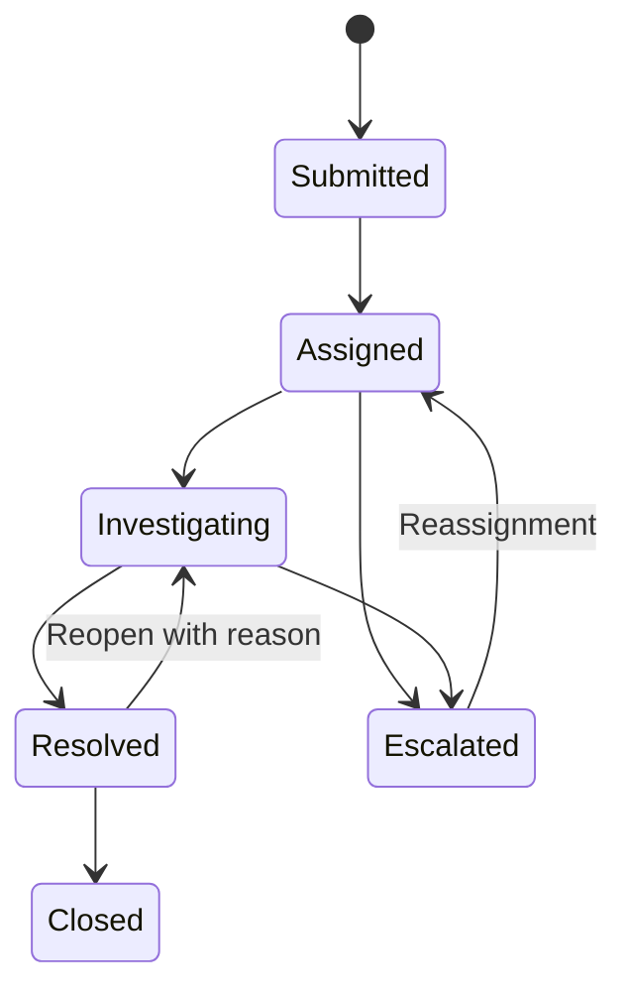

# ResolveX — Design Patterns

ResolveX uses four core design patterns to keep complaint workflow rules explicit, classification providers interchangeable, escalation policy composable and side effects decoupled from domain operations.

## 1. State Pattern

**Implementation:** `server/src/domain/complaintState.js`

The complaint lifecycle is modelled as states with explicit outgoing transitions, actor permissions and transition requirements.

High-level lifecycle:



The domain state machine is the authority for whether a transition is valid. Controllers/services request a transition rather than duplicating status checks across endpoints.

Benefits:

- Invalid transitions are rejected centrally.
- Actor permissions are checked with the transition.
- Resolution and closure requirements can be enforced consistently.
- The client can request available transitions from the same domain rules.
- Database enums and CHECK constraints provide a persistence-level safety net.

## 2. Strategy Pattern

**Implementation:** `server/src/services/ai/`

Classification uses interchangeable strategies behind a common interface. The documented fallback order is:

```text
Anthropic provider → OpenAI provider → deterministic keyword classifier
```

The classifier validates provider output against the supported taxonomy and expected structure. Provider failures, timeouts, refusals, unsupported categories or insufficient confidence can cause the next strategy to be attempted.

Benefits:

- Providers can be added or replaced without rewriting complaint workflow code.
- The keyword strategy provides a deterministic fallback.
- The selected strategy and confidence can be retained for diagnostics.
- External AI outages do not have to prevent complaint submission.

AI classification supports initial triage. Human staff remain responsible for investigating and resolving complaints.

## 3. Chain of Responsibility

**Implementation:** `server/src/services/escalation/`

Escalation policy is represented as a chain of handlers. Each handler evaluates a condition and either returns a decision or passes evaluation to the next handler.

The chain considers terminal states, maximum escalation level, recent activity and configured escalation thresholds. The policy decision is separated from database writes; the escalation service executes the selected action transactionally.

Benefits:

- Individual escalation rules can be tested independently.
- Rules can be reordered or extended without building one large conditional block.
- The chain can return no action when a complaint is not eligible.
- Transactional execution and uniqueness constraints help prevent duplicate escalation events.

## 4. Observer Pattern

**Implementation:** `server/src/events/`

The domain publishes events after successful transaction commit. Observers respond to those events, for example by:

- Persisting a notification record.
- Emitting a Socket.IO event to the relevant user.
- Sending an email.

Observers are isolated so a delivery failure does not undo a complaint transition that has already committed. Blocking persistence work and asynchronous delivery work are handled deliberately.

Benefits:

- Complaint business logic does not need to know every delivery channel.
- New observers can be added with limited changes to the domain workflow.
- Email or realtime delivery problems can be logged and retried/diagnosed separately.
- Events are emitted only after committed data is available.

## 5. How the patterns work together

Example: a student submits a complaint.

1. The complaint service invokes the classification Strategy.
2. The State pattern controls the legal lifecycle transition and permissions.
3. The database transaction persists the complaint and status history.
4. After commit, the Observer pattern triggers notification and realtime side effects.
5. The scheduled escalation worker later evaluates the complaint through the Chain of Responsibility.

Each pattern addresses a different design problem; they are complementary rather than interchangeable.
